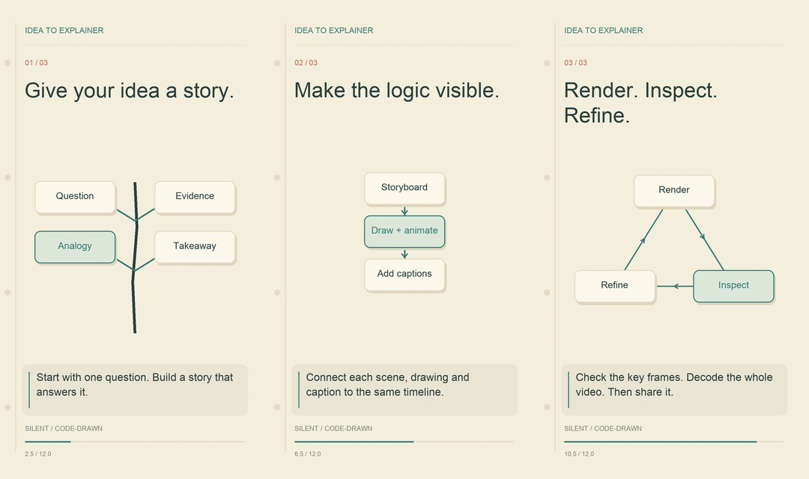

# Sketch Video Skill

**从一个想法，到一支有逻辑、有动画、有字幕的科普视频。**

用代码把知识画出来：纸张底色、手绘线条、逐步生长的关系图，再配上一条可以核对的字幕时间线。

[English](README.md) · [Skill 入口](SKILL.md) · [12 秒演示](docs/demo.mp4) · [中文示例](docs/water-cycle.mp4) · [实测记录](docs/validation.md)



## 不只做出画面，也把过程交出来

这是一套可复用的 Agent Skill，附带可独立运行的本地渲染器。它从此前完成的 38 秒样片、五分钟中文手绘科普片中提炼绘图、时间线和质检方法，再用 JSON 分镜扩展到其他主题。

- **代码原创绘图**：固定纸张纹理、渐进描线、树形关系、流程和循环动画。
- **字幕共用时钟**：画内字幕、SRT、讲稿来自同一份帧时间线。
- **结果可以检查**：每镜开始／中段／结束图、联系表、完整视频解码验证。
- **本地即可渲染**：Python、Pillow、fontTools、FFmpeg；示例不需要 API Key，也不下载模型。
- **中英文示例**：显式指定字体，预先检查缺字与文字溢出。

默认输出为 **1080×1920、24 fps、H.264 无声竖屏视频**。事实核查、叙事和画面审阅由 Agent 与使用者完成；渲染器不会自动把一句提示变成经过核查的完整课程。内置三种通用图示，更具体的学科插画需要扩展绘图代码。

## 先跑一个最小示例

需要 Python 3.10+、带 `libx264` 的 FFmpeg/ffprobe，以及本地 TTF/OTF/TTC 字体。请先用系统包管理器安装 FFmpeg。英文可用 DejaVu Sans，中文可用 Noto Sans CJK；仓库不附带字体或可执行程序。

```bash
git clone https://github.com/Karl-Dai/sketch-video-skill.git
cd sketch-video-skill
python3 -m venv .venv
source .venv/bin/activate
python -m pip install -r requirements.txt
python scripts/render.py examples/idea-to-video.json --out build/demo --size 360x640
python scripts/verify.py build/demo
```

Windows 使用 `.venv\Scripts\Activate.ps1` 激活环境，并用 `--font "C:\path\to\font.ttf"` 指定字体。其他系统若自动查找失败，可传 `--font /path/to/font.ttf` 或设置 `SKETCH_FONT`。每次指定一个**新的输出目录**，程序会拒绝覆盖已有目录。

输出包含 `video.mp4`、`captions.srt`、`narration.txt`、`timeline.json`、分镜质检图，以及渲染和验证报告。

```bash
# 先检查中文分镜，不编码视频
python scripts/render.py examples/water-cycle.zh.json --out build/water-preview \
  --font /path/to/NotoSansCJK-Regular.ttc --preview-only

# 正式渲染省略 --size，默认 1080×1920
python scripts/render.py examples/water-cycle.zh.json --out build/water-hd \
  --font /path/to/NotoSansCJK-Regular.ttc
python scripts/verify.py build/water-hd
```

中文水循环示例的事实依据见[资料清单](examples/sources.md)。还需要逐镜看图、检查字幕阅读时间并播放全片；解码通过不能替代内容与画面审阅。

## 安装为 Agent Skill

在 Codex 中，把本目录复制到配置的技能目录，通常为 `~/.codex/skills/sketch-video-skill`。保留 `SKILL.md`、`scripts/`、`references/`、`examples/` 的相对结构；如目标已存在，先检查用途。用虚拟环境安装 Python 依赖，确保 FFmpeg 可用，必要时刷新技能发现。兼容 Agent 也可以直接加载 `SKILL.md`；脚本本身不依赖特定 Agent 平台。

可以这样使用：

> 使用 $sketch-video-skill，给好奇的中学生解释电池怎样储存能量。做一支 45 秒中文无声竖屏科普视频，核对科学事实，使用代码原创示意图，保留字幕，并给我看质检分镜。

完整流程：明确目标 → 查证资料 → 写讲稿 → 分镜 → 代码动画 → 字幕 → 渲染 → 看图 → 全片解码。入口在 [SKILL.md](SKILL.md)。

## 换一个主题

1. 从[创作简报](examples/brief.md)和事实来源表开始，先确定观众看完能理解什么。
2. 修改[示例 JSON](examples/idea-to-video.json)里的标题、时长、标签和字幕。
3. 用 `tree` 表示分枝关系，`process` 表示步骤，`cycle` 表示循环；不合适的图示需要改代码。
4. 先预览再渲染，修改讲稿时同步修改字幕和时间安排。

详细说明见[分镜格式](references/storyboard.md)、[制作方法](references/workflow.md)和[可复现实测](docs/validation.md)。字幕按文字长度分配时间，未做语音对齐。当前渲染器为单进程，没有实时渲染或长片加速承诺。

## 配音：可选，仍属实验

核心无声动画和字幕流程可以独立运行。上游 Kokoro 中文 ONNX 短段试听通过音频技术检查，但尚无获认可的最终音色，也未完成整片配音。自然度和生产可用性尚未验证。本仓库不提供 TTS 适配器或模型安装器；扩展前请阅读[配音流程与边界](references/voice.md)。

## 开源范围

[MIT 许可](LICENSE)覆盖我们原创的代码、文档和代码绘制的演示画面。第三方依赖、模型、声音、字体和素材保留各自许可，见 [NOTICE.md](NOTICE.md)。不打包模型权重和字体。制作视频不代表授权向社交平台发布，本项目也没有外部发布功能。
